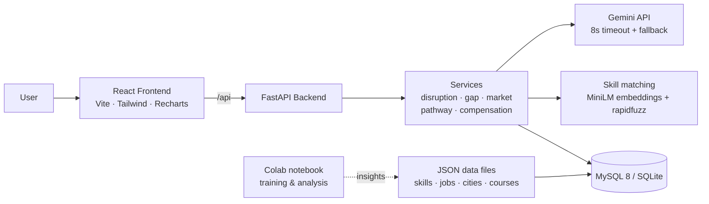

<div align="center">

# Punarshuru

### AI Career Intelligence for Disruption, Transition & Growth — Bharat 2.0

**Detect the disruption. Understand the gap. Find the next move.**

[](https://drive.google.com/file/d/1dsgd-CW8HZfO1XmsPP8cUMX5p_s8hg9T/view?usp=drive_link)
[](https://colab.research.google.com/drive/1qZUPxDNGF8NalXEPPo0_YWOuVXOB9GIc?usp=sharing)
[](https://drive.google.com/drive/folders/1lU4u5sTFOjjA64JQAcDNGaAhxeo8DsEV?usp=sharing)


</div>

---

## 📌 Project Links

| Resource | Description | Link |
|---|---|---|
| 🎥 **Demo Video** | Full walkthrough of Punarshuru using the demo personas | [Watch on Google Drive](https://drive.google.com/file/d/1dsgd-CW8HZfO1XmsPP8cUMX5p_s8hg9T/view?usp=drive_link) |
| 📓 **Model Training Notebook** | Data preparation, analysis, model training and evaluation | [Open in Google Colab](https://colab.research.google.com/drive/1qZUPxDNGF8NalXEPPo0_YWOuVXOB9GIc?usp=sharing) |
| 📂 **Dataset** | All datasets used for analysis and model training | [Open Google Drive folder](https://drive.google.com/drive/folders/1lU4u5sTFOjjA64JQAcDNGaAhxeo8DsEV?usp=sharing) |

> To re-run the training: open the Colab notebook → **File → Save a copy in Drive** → add the dataset folder to your Drive → **Runtime → Run all**.

---

## 🧭 The Problem

Lakhs of Indians face a career disruption every year — a career break, a layoff, gig work with no formal record, years of stagnation, or a degree that does not match what industry hires for. Existing tools solve one slice: job portals list openings, learning platforms list courses, salary tools show numbers. None of them answer the one question everyone in transition asks:

> **"Where do my skills stand right now, and what is my next concrete step?"**

## 💡 Our Solution

Punarshuru connects the whole journey — **Disruption → Skills → Market → Action** — in one place.

| Module | What it does |
|---|---|
| **AI Career Profile** | Builds a dynamic profile from education, skills, experience, career gaps and goals (resume upload or manual entry) |
| **Skill & Market Intelligence** | Compares the user's skills with real Indian job-market demand to find gaps, transferable skills and rising/declining skills |
| **Career Pathway Engine** | Maps a personalised transition path with free courses (NPTEL, SWAYAM, Skill India, freeCodeCamp) |
| **Compensation & Growth Intelligence** | Goes beyond salary — adjusts for city rent, commute and cost of living to show *real* compensation |
| **Skill Passport** | A portable, shareable (QR) record of a user's verified skills and progress |

## 👥 Who It's For

| Persona | Situation | Punarshuru gives them |
|---|---|---|
| Career-break returners | Lost track of how far the industry moved | How far the market has moved and how to catch up |
| Gig & informal workers | No formal record of their skills | A portable skill passport |
| Laid-off professionals | Need a pivot, fast | Data-backed pivot paths |
| Employed but stagnant | Can't benchmark themselves | A benchmark of where they stand |
| Students & graduates | Curriculum ≠ industry demand | The curriculum-vs-demand gap |

---

## 🛠️ Tech Stack

| Layer | Technology |
|---|---|
| **Frontend** | React 18, TypeScript, Vite, Tailwind CSS, shadcn/ui, React Router, TanStack Query, Zustand, Recharts, Framer Motion, lucide-react, react-i18next (EN/HI), qrcode.react |
| **Backend** | FastAPI, SQLAlchemy 2 (async), Pydantic 2, MySQL (SQLite fallback), sentence-transformers `all-MiniLM-L6-v2`, rapidfuzz, Gemini API |
| **Database** | MySQL 8.0 (Docker) |
| **ML / Analysis** | Python notebook on Google Colab ([open](https://colab.research.google.com/drive/1qZUPxDNGF8NalXEPPo0_YWOuVXOB9GIc?usp=sharing)) |
| **Ports** | Frontend `5173` (proxies `/api`), Backend `8000` |

## 🏗️ Architecture



---

## 🚀 Quick Start (Local Dev — No Docker)

### 1. Backend

```bash
cd backend

# Create venv
python -m venv .venv
.venv\Scripts\activate          # Windows
# source .venv/bin/activate     # Linux/Mac

# Install dependencies
pip install -r requirements.txt

# Configure env (SQLite is used as fallback if DATABASE_URL is not set)
copy .env.example .env           # Windows
# cp .env.example .env           # Linux/Mac

# Start the API server
uvicorn app.main:app --reload --port 8000
```

API docs: **http://localhost:8000/api/docs**

### 2. Seed demo data

```bash
cd backend
python -m app.scripts.seed
```

This validates all 5 JSON data files and inserts the 5 demo personas into the database.

### 3. Frontend

```bash
cd frontend
npm install
npm run dev
```

App: **http://localhost:5173** — the Vite dev server proxies `/api` → `http://localhost:8000`.

## 🐳 Docker (MySQL + Full Stack)

```bash
# 1. Copy and edit backend env
copy backend\.env.example backend\.env      # Windows
# cp backend/.env.example backend/.env      # Linux/Mac

# 2. Start everything
docker compose up --build

# 3. Seed personas (in a separate terminal)
docker exec punarshuru_backend python -m app.scripts.seed
```

| Service | URL |
|---|---|
| Frontend | http://localhost:5173 |
| Backend API docs | http://localhost:8000/api/docs |
| MySQL | `localhost:3306` (user: `punarshuru`, pw: `punarshuru123`, db: `punarshuru`) |

> ⚠️ The MySQL credentials above are for local development only. Change them before any deployment.

---

## 🤖 Models & Data

### Training notebook

All data preparation, exploratory analysis, model training and evaluation is in the Colab notebook:

👉 **[Open the notebook in Google Colab](https://colab.research.google.com/drive/1qZUPxDNGF8NalXEPPo0_YWOuVXOB9GIc?usp=sharing)**

### Dataset

The raw datasets used by the notebook are in a shared Google Drive folder:

👉 **[Open the dataset folder](https://drive.google.com/drive/folders/1lU4u5sTFOjjA64JQAcDNGaAhxeo8DsEV?usp=sharing)**

### App data files (`backend/app/data/`)

| File | Count | Description |
|---|---|---|
| `skills_taxonomy.json` | 250 | Skills with id, name, aliases, category, demand_trend, automation_risk |
| `jobs_snapshot.json` | 300 | Indian job postings with salary (LPA), city, skills, remote flag |
| `city_costs.json` | 12 | City cost-of-living index (Mohali = 1), rent, commute |
| `courses.json` | 120 | Free courses: NPTEL, SWAYAM, Skill India, freeCodeCamp |
| `personas.json` | 5 | Demo personas: Priya, Ramesh, Arjun, Sneha, Rohit |

---

## 🔌 API Endpoints

| Method | Path | Description |
|---|---|---|
| `GET` | `/api/health` | Liveness probe |
| `GET` | `/api/demo/personas` | List all demo personas |
| `POST` | `/api/demo/load/{key}` | Load a full persona (`priya` / `ramesh` / `arjun` / `sneha` / `rohit`) |
| `GET` | `/api/market/trends` | Rising / declining / stable skills |
| `GET` | `/api/market/roles/{id}` | Job role snapshot by ID |

Full interactive docs: **http://localhost:8000/api/docs**

## 🎭 Demo Personas

Watch them in action in the **[demo video](https://drive.google.com/file/d/1dsgd-CW8HZfO1XmsPP8cUMX5p_s8hg9T/view?usp=drive_link)**.

| Key | Name | Type | City | Story |
|---|---|---|---|---|
| `priya` | Priya Sharma | Returner | Pune | Ex-Java dev, 4-year maternity break → GenAI |
| `ramesh` | Ramesh Kumar | Gig | Lucknow | Swiggy delivery → Logistics Tech |
| `arjun` | Arjun Mehta | Laid off | Bengaluru | Manual QA laid off → Automation SDET |
| `sneha` | Sneha Patel | Stagnant | Noida | 3 years in support → AI Chatbot Trainer |
| `rohit` | Rohit Singh | Student | Mohali | Final-year BTech → SWE/ML |

---

## 📁 Project Structure

```
Punarshuru/
├── backend/
│   ├── app/
│   │   ├── core/           # config.py, database.py
│   │   ├── models/         # ORM: profile.py, passport.py
│   │   ├── schemas/        # Pydantic schemas
│   │   ├── routers/        # health.py, demo.py, market.py
│   │   ├── services/       # disruption, gap, market, pathway, compensation engines
│   │   ├── data/           # All JSON data files
│   │   └── scripts/        # seed.py
│   ├── requirements.txt
│   ├── .env.example
│   └── Dockerfile
├── frontend/
│   ├── src/
│   │   ├── app/            # App-level config
│   │   ├── components/
│   │   │   ├── ui/         # shadcn/ui components
│   │   │   ├── layout/     # Navbar.tsx, AppLayout.tsx
│   │   │   ├── charts/     # Recharts wrappers
│   │   │   └── common/     # HealthBadge.tsx
│   │   ├── features/       # Feature modules
│   │   ├── pages/          # LandingPage, DashboardPage, ...
│   │   ├── lib/            # api.ts, utils.ts
│   │   ├── store/          # profileStore.ts (Zustand)
│   │   ├── types/          # index.ts
│   │   └── i18n/           # EN + HI translations
│   ├── vite.config.ts
│   └── Dockerfile
├── docker/
│   └── mysql/
│       └── init.sql
├── docker-compose.yml
└── README.md
```

## 📐 Engineering Principles

- **Demo never breaks** — every AI call has a fallback and an 8-second timeout; the app works even without `GEMINI_API_KEY`.
- **India-first content** — no lorem ipsum; every role, city, salary and course is India-specific.
- **Clean code** — no `any` in TypeScript, components under 200 lines, business logic lives in services.
- **Polished UX** — skeleton, empty and error states everywhere; responsive from 375 px to 1440 px.
- **Indian formatting** — salaries shown as **₹X LPA**; UI available in **English and Hindi**.

## 🗺️ Roadmap

- [x] Profile builder, skill-gap analysis, career pathways, compensation and skill passport
- [x] 5 end-to-end demo personas
- [ ] Live job-market data (TinyFish Agent / Search / Fetch APIs) to replace the static snapshot
- [ ] College and employer dashboards
- [ ] Verified skill passport with partner integrations

## 👩‍💻 Team IT WIZARDS — Chandigarh University

| Name | Role |
|---|---|
| **Vibha Rajput** | Team Lead · System Architect |
| **Rashika** | AI/ML Engineer |
| **Naina Kumari** | Product & UI/UX Lead |
| **Tanveer Kaur** | Full Stack Developer |

---

<div align="center">

**Punarshuru — har restart, sahi data ke saath.**

[🎥 Demo Video](https://drive.google.com/file/d/1dsgd-CW8HZfO1XmsPP8cUMX5p_s8hg9T/view?usp=drive_link) · [📓 Colab Notebook](https://colab.research.google.com/drive/1qZUPxDNGF8NalXEPPo0_YWOuVXOB9GIc?usp=sharing) · [📂 Dataset](https://drive.google.com/drive/folders/1lU4u5sTFOjjA64JQAcDNGaAhxeo8DsEV?usp=sharing)

</div>
